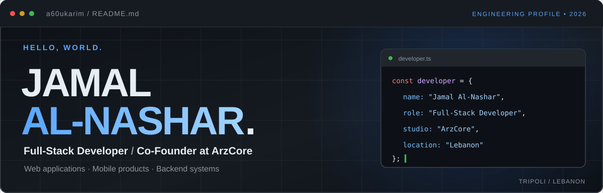
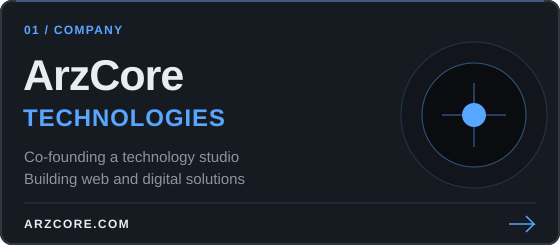
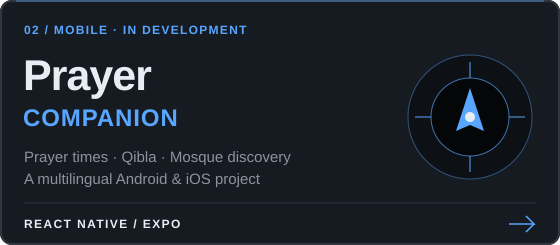
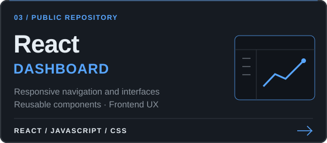
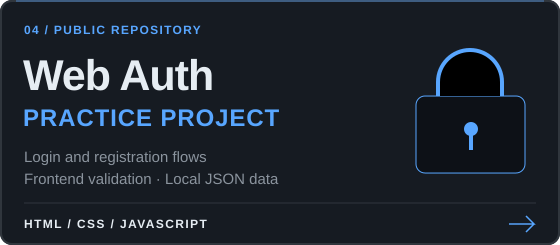
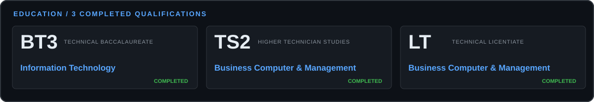
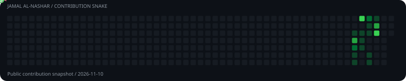

 

**Full-Stack Developer · Co-Founder at [ArzCore Technologies](https://arzcore.com)**
Tripoli, Lebanon · Web & mobile applications · Arabic / English with RTL support

  
  

---

## About

I build practical web applications, backend systems, and responsive interfaces, and I work on cross-platform mobile apps with **React Native & Expo**. My work covers content platforms, dashboards, authentication practice projects, and mobile apps. I like turning ideas into clear, useful digital experiences.

- **Role:** Co-Founder & Full-Stack Developer at ArzCore Technologies
- **Focus:** frontend, backend, databases, deployment, and maintenance
- **Mobile:** React Native & Expo for Android and iOS
- **Open to:** software projects, development opportunities, and collaboration

---

## Experience

**Co-Founder & Full-Stack Developer · ArzCore Technologies** · Lebanon

I work with my co-founder on planning and building digital products for clients in Lebanon and abroad: frontend implementation, backend development, databases, responsive interfaces, deployment, and maintenance.

---

## Projects

<table>
  <tr>
    <td width="50%" align="center"></td>
    <td width="50%" align="center"></td>
  </tr>
  <tr>
    <td width="50%" align="center"></td>
    <td width="50%" align="center"></td>
  </tr>
</table>

**More projects**

- **ArzDesk**: an open-source business workspace for freelancers and small teams. It runs online with accounts and roles, or offline with local storage and JSON backups. *Next.js · React · TypeScript · PostgreSQL · Drizzle ORM · Tailwind CSS*. [Source](https://github.com/a60ukarim/ArzDesk)
- **News & Content Platform**: a database-driven publishing site with an admin dashboard, news and statement management, media uploads, and a responsive interface. *PHP · MySQL · JavaScript*
- **بطريقك (Ride-Sharing App)**: a mobile carpooling app connecting drivers and passengers. *React Native · Expo · in development*
- **Prayer Companion**: an Islamic companion app covering prayer times, Adhan notifications, nearby mosques, Qibla direction, Quran, supplications, and multilingual support. *React Native · Expo · in development*. [Privacy policy](https://prayer-companion-privacy.vercel.app)

---

## Tech Stack

  

 

**Core stack:** React · TypeScript · JavaScript · Node.js · PHP · SQL · HTML/CSS · Cloudflare · Git/GitHub
**Mobile:** React Native · Expo
**Areas I enjoy:** full-stack development · mobile apps · database design · responsive interfaces · Arabic/English UX

---

## Education

  

Three qualifications from the Lebanese Technical Education System: **BT3** (Information Technology), **TS2** (Business Computer & Management), and **LT** (Informatics, Software Development). They gave me a foundation in programming, computer systems, databases, and business applications.

**Languages:** Arabic (native) · English (continuing to improve)

---

## GitHub Stats

  
  
   
  

---

## Contribution Snake

  

A looping animation of my public contribution calendar, refreshed daily.

---

## Current Focus

- Building practical web and mobile applications
- Improving ArzDesk, an open-source online and offline business workspace
- Developing Prayer Companion and بطريقك
- Improving application performance, navigation, and usability
- Growing ArzCore Technologies through useful digital products

---

## Let's connect

If you're working on **websites, mobile apps, business software, or full-stack products**, I'd be glad to talk.

<a href="https://arzcore.com"><strong>ArzCore Technologies</strong></a> · <a href="https://github.com/a60ukarim?tab=repositories"><strong>GitHub Repositories</strong></a>

